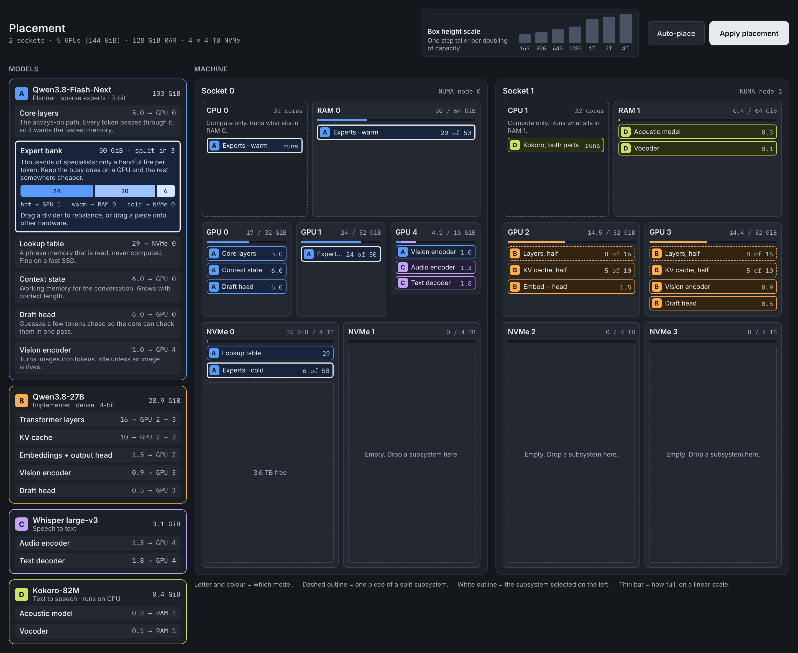

# ai-engine

The most boringly named inference engine.

A placement-aware inference control plane: ollama-like ergonomics, but with
explicit, editable control over how each part of a model is spread across GPUs,
RAM, and SSD. For running serious model workloads on your own hardware.



## Start here

- **[docs/vision.md](docs/vision.md)** — the problem, the product, and the
  roadmap (MVP → ollama parity → any Hugging Face model).
- **[docs/decisions.md](docs/decisions.md)** — why it's a control plane over
  existing engines rather than a new engine, the boundary we'd own, and why the
  MVP ships on llama.cpp.
- **[docs/features.md](docs/features.md)** — feature breakdown by stage.
- **[docs/architecture.md](docs/architecture.md)** — components, the placement
  pipeline, and the decisions behind them.
- **[spikes/placement/](spikes/placement/README.md)** — a working proof that a
  Rust control plane can place each part of a model on a specific device or in
  managed RAM through llama.cpp's C API, verified on 2× V100 by checking where
  every weight actually is.

## Quick start

Linux, Rust 1.100+, cmake, clang (for bindgen), protoc. CUDA 12.x for NVIDIA
GPUs (12.x still builds for Volta / V100; CUDA 13 doesn't).

```bash
git submodule update --init
cargo build --release -p ai-engine                  # CPU only
cargo build --release -p ai-engine --features cuda  # NVIDIA; CUDA_ARCHITECTURES=70 by default

target/release/ai-engine serve &                    # API on 127.0.0.1:11435, data in ~/.ai-engine
target/release/ai-engine pull hf.co/Qwen/Qwen3-8B-GGUF:Q4_K_M
curl -s localhost:11435/api/chat -d '{"model":"hf.co/Qwen/Qwen3-8B-GGUF","messages":[{"role":"user","content":"Hi"}]}'
target/release/ai-engine place hf.co/Qwen/Qwen3-8B-GGUF   # where every weight really is
```

The API is ollama-compatible under `/api` and OpenAI-compatible under `/v1`,
so existing clients work by pointing them at port 11435. Placement:
`GET/PUT /api/aie/placement`, or `ai-engine place MODEL --set intent.json`
(see [crates/plan](crates/plan/src/lib.rs) for the intent format).

Settings go in `~/.ai-engine/config.toml` (`listen`, `store`, `keep_alive`,
`n_ctx`, `n_batch`, `threads`, `load_timeout`) or `AIE_HOME` / `AIE_HOST`.

## Status

The MVP's serving path works end to end on CPU and is tested against real
models; the GPU path builds but hasn't run since the spike (the test box is
busy). Against the MVP list in [features.md](docs/features.md):

| Area | Done | Not yet |
|---|---|---|
| Install | one binary (daemon, worker, CLI); config file; CUDA build | systemd unit; release builds for other CPUs (built with `GGML_NATIVE`) |
| Models | pull by Hugging Face shorthand (verified, resumable, split models); local GGUF files; list, remove | OCI registries; choosing the disk per model |
| Serving | ollama and OpenAI APIs with streaming; several models at once; keep-alive; one request at a time per model | |
| Placement | anatomy; auto-place (llama.cpp's fit); intents by share per tier; fit check; apply on reload; every load verified weight by weight | web UI; machine view; cross-check of overhead estimates with llama.cpp's dry run |
| Monitoring | tokens and timings per response | per-model and per-device metrics; disk-tier residency |

## Layout

```
crates/
  gguf/        GGUF header reader (cross-checked against llama.cpp's)
  anatomy/     model -> subsystems with sizes
  plan/        intent -> plan -> fit check -> llama.cpp settings
  store/       model store: Hugging Face pulls into content-addressed blobs
  llama/       llama.cpp backend: static build, placement, verification, generation
  proto/       daemon <-> worker gRPC protocol
  worker/      one process per loaded model
  daemon/      lifecycle, ollama/OpenAI/placement APIs
  cli/         the ai-engine binary
docs/          vision, decisions, features, architecture
fixtures/      header-only GGUFs of real models, for tests
spikes/        throwaway experiments that answer one question each
tools/         dep-age.py: how old each locked dependency is
vendor/        pinned dependencies as submodules (llama.cpp)
```

Tests that need a real model use Qwen3-0.6B (`cargo run -p aie-store --example
pull -- ~/aie-store hf.co/Qwen/Qwen3-0.6B-GGUF`) and skip without it.
