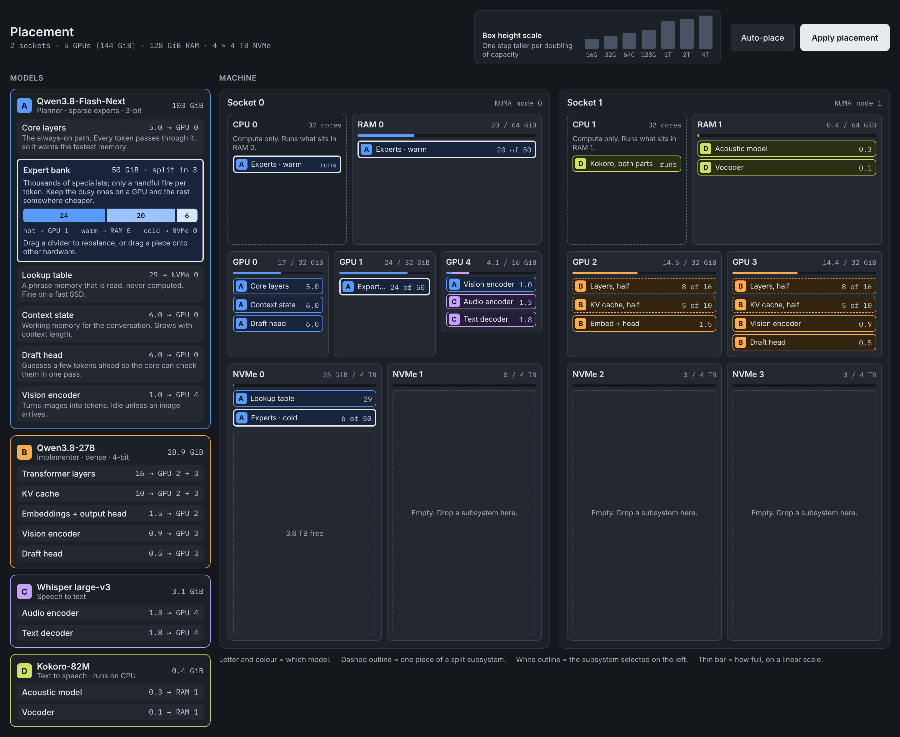

# Vision

## The gap

There's a missing tier in the inference-engine landscape.

- **ollama** is easy to run, but it gives you little control over *where* a model
  is placed across your hardware. It decides for you.
- **llama.cpp** is the flexible classic, but it runs one model at a time, needs
  a helper like llama-swap to behave like ollama, and its placement controls are
  coarse — mostly "how many layers on the GPU."
- **The model-aware platforms** (strata, polystrata, ninfer and similar) have the
  smarts, but they're full platforms: either you assemble a production deployment
  from many parts, or you accept an all-in-one appliance that hides the knobs.

What's missing is the middle: something with ollama's "just run it" ergonomics,
but with real, explicit control over how a model is spread across GPUs, RAM, and
SSD — aimed at people running serious workloads on their own hardware. Call it
"ollama for production," a **control plane**, not a platform.

## The product

A placement-aware inference control plane.

The defining feature is the one from the UI mockup: a simplified picture of the
machine (GPUs, RAM, SSD, sized logarithmically by capacity), with each model
broken into its major subsystems — attention, routed experts, shared experts,
embeddings, the output head — and each subsystem assigned to a piece of hardware,
or split across several. The operator can see the placement and edit it; the
engine makes the hosting work. Several models run at once, and which bytes of
which model sit where stays legible.

UI prototype — a static mockup; the image above is a render of it:
<https://claude.ai/artifact/JAwsY5NKMVw8kj1uMePY9d>

Note the "Expert bank" in the mockup, split three ways — hot experts on a GPU,
warm in RAM, cold on NVMe. That three-tier split is exactly what the
[placement spike](../spikes/placement/README.md) set out to prove is buildable.

## Wrapper or engine?

**A control plane — a thick wrapper over existing engines — not a from-scratch
inference engine.** The matrix-multiply code underneath is not where the value
is, and re-implementing it is a large, thankless job. The value is in deciding
*where every piece of a model lives* and then making the backend honor that. See
[decisions.md](decisions.md) for the reasoning and the evidence.

The dividing line we're drawing is roughly: **own the loader and the memory
manager; borrow the compute kernels.** The engine we write reads model files,
decides where every tensor (and eventually every expert) lives, manages the
GPU/RAM/SSD tiers and the KV cache, and moves data between tiers. The actual math
is handed to an existing kernel library (ggml via llama.cpp's C API to start).

The [placement spike](../spikes/placement/README.md) confirmed this is feasible
without writing any C++: llama.cpp used as a library already lets a Rust control
plane place each weight on a specific device or in RAM we manage ourselves, with
bit-identical output.

## Roadmap

| Stage | Target | Backend | What we mostly build |
|---|---|---|---|
| **MVP** | Works with a couple of specific model families (Qwen3 dense + MoE) | llama.cpp | Model-anatomy parser, memory estimator, placement compiler (rules → backend flags), process/lifecycle manager |
| **v1** | Feature-compatible with ollama | Same | Model pulling + registry, keep-alive, ollama/OpenAI-compatible APIs, a Modelfile equivalent |
| **v2** | Any model on Hugging Face (within backend limits) | Add vLLM / SGLang | Per-backend capability model, UI that adapts to what each backend can actually place |

"Wrapper now, own engine later" holds for now. The GPU spike found llama.cpp's
placement leaks a little but works, and no other engine does better on this
hardware (D5 in [decisions.md](decisions.md)). The MVP has to be as easy to use
as ollama, so some v1 items may move into it; see the open questions in
[features.md](features.md). The custom engine comes after the MVP proves demand.

## Status

- Product direction: documented here, not yet built.
- Placement feasibility: confirmed on CPU and on 2× V100, with every weight's
  location checked. See [../spikes/placement/README.md](../spikes/placement/README.md).
- Feature and architecture breakdown: drafted in [features.md](features.md) and
  [architecture.md](architecture.md).
- Everything else in the roadmap: not started.
